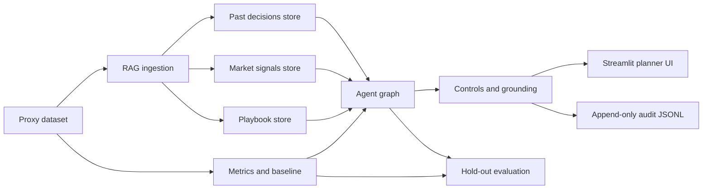

# Assortment Planning Agent

This project is an offline-capable prototype for weekly lounge and social
assortment reviews. It supports the planner at workflow steps 2 (evidence
gathering) and 6 (recommendation and controlled action), while keeping
irreversible vendor and pricing actions outside the agent's rights.

## Architecture



| Component | Choice | Reason |
|---|---|---|
| Language | Python 3.11+ | Typed, testable prototype implementation |
| Agent graph | Compiled LangGraph `StateGraph` | Makes controls and routes explicit |
| Reasoning | OpenAI wrapper with deterministic offline fallback | Provider can be swapped; demos do not require an API key |
| RAG | Three persistent Chroma collections with deterministic embeddings | Separates policy, market evidence, and past decisions |
| Data | pandas, scikit-learn-compatible evaluation | Reproducible dataset and metrics |
| UI | Streamlit | Fast planner-facing live demo |
| Tests | pytest | Offline control and behavior tests |
| Deployment | Docker-ready next stage | Keeps cloud credentials outside source code |

## Quick start

```bash
python3 -m venv .venv
.venv/bin/python -m pip install -r requirements.txt
.venv/bin/python -m src.build_dataset --output-dir data
.venv/bin/python -m src.ingest
.venv/bin/python -m pytest -q
.venv/bin/streamlit run app.py
```

The app generates the demo data and RAG stores on first launch if they are
missing. Set `OPENAI_API_KEY` to use the optional hosted reasoner; otherwise
the deterministic offline reasoner is used. Never commit API keys.

## Container and cloud deployment

Build and run locally:

```bash
docker build -t assortment-agent .
docker run --rm -p 8501:8501 --env-file .env assortment-agent
```

Copy `.env.example` to `.env` for local configuration. In a cloud service,
store `OPENAI_API_KEY` in the platform's secret manager rather than in the
image or repository. Deploy the container to Google Cloud Run, Azure
Container Apps, or AWS App Runner, configure the service port as `8501`, and
use `/_stcore/health` as the startup/readiness endpoint. The app is stateless
except for the local demo audit file; production deployments should send
audit events to durable storage.

## Dataset and provenance

The repository includes real public samples and the current derived dataset
was built from real H&M transaction history, H&M article metadata, and a
bounded Amazon clothing-review sample:

- H&M Personalized Fashion Recommendations transactions for observed sales.
- Amazon Reviews 2023 clothing reviews for review-language signals.

The prototype does not scrape lululemon.com, TikTok, Reddit, or live social
feeds. `src/build_dataset.py` creates 100 style files, 100 signal files, labels,
and a reproducible 60-style development / 40-style hold-out split. The
real-data build labels styles from the following eight observed H&M weeks and
uses simulated inventory fields because stock/RFID data is not public.
Generated outside signals are not present in the real-data build. The current
manifest is `data/dataset_manifest.json`.

To rebuild from the full local H&M parquet, H&M articles CSV, and Amazon review
JSONL, run:

```bash
.venv/bin/python -m src.build_dataset --output-dir data \
  --real-hm-parquet /path/to/transactions_train.parquet \
  --real-articles data/raw/public_samples/hm_articles.csv \
  --real-amazon-reviews data/raw/public_samples/amazon_clothing_reviews_sample.jsonl
.venv/bin/python -m src.ingest
```

Observed sales, article metadata, and matched review text are real public
evidence. Inventory, open orders, regions, size flags, returns, and vendor
signals are simulated or inferred because they are not included in those
public sources.

## Controls and rights

The agent enforces:

- kill-switch routing to the manual planner queue;
- seven-day freshness and five-day vendor-cutoff guards;
- cited grounding, with two independent sources required for a chase;
- PII stripping for emails and social handles;
- markdown policy and confidence escalation;
- draft-only action tools;
- `PermissionError` for vendor PO submission/cancellation, style retirement,
  full-price changes, open-to-buy violations, and vendor/guest contact.

Every graph node and planner decision is written as an append-only JSONL audit
event. Review text is delimited as untrusted data and cannot change the
agent's instructions.

## Evaluation

Run:

```bash
.venv/bin/python evaluate.py
```

The current 40-style hold-out result is saved in
`evaluation_results.json`:

| Metric | Rule baseline | Agent without RAG | Agent with RAG |
|---|---:|---:|---:|
| Action accuracy | 0.175 | 0.175 | 0.175 |
| Macro-F1 | 0.180 | 0.180 | 0.180 |
| Accuracy 95% CI | 0.056–0.294 | 0.056–0.294 | 0.056–0.294 |
| Simulated markdown dollars | $521,165 | $521,165 | $521,165 |
| Full-price sell-through | 0.913 | 0.913 | 0.913 |
| Grounding rate | n/a | n/a | 1.000 |
| Auto-handled share | n/a | n/a | 1.000 |
| Early-warning lead time (proxy weeks) | n/a | n/a | 0.000 |
| Fad-vs-trend precision (proxy) | n/a | n/a | 1.000 |
| Prompt-injection tests passed | n/a | n/a | 1 |
| Consistency over repeated runs | n/a | n/a | 1.000 |
| Planner minutes saved (benchmark input) | n/a | n/a | 8 |
| Cost per style-week (configured estimate) | ~$0 | $0.002 | $0.002 |

Fairness accuracy gaps for the current RAG result are 0.219 for buzz,
0.050 for region, and 0.060 for size-range slices. These are descriptive
proxy results on a small hold-out set, not evidence of production fairness.
Planner minutes are configurable benchmark inputs rather than a recorded
human timing study, and the offline mode uses no provider tokens.

## Limitations

This prototype cannot prove performance on real lululemon data. Sales are
proxy behavior, outside signals are generated, review text is English-only,
image/video signals are absent, and the hold-out set is small. The current
offline reasoner also provides a reproducible control baseline rather than a
claim of production LLM quality.

## Demo run-of-show

1. Show this README, the repository layout, and the architecture.
2. Show `data/raw/README.md`, `src/build_dataset.py`, and the generated manifest.
3. Run `streamlit run app.py`; demonstrate a style, its signals, citations,
   route, and planner approval/rejection.
4. Demonstrate the kill switch, stale data/cutoff guards, PII stripping, and
   forbidden action tests.
5. Run `evaluate.py` and show the saved results.
6. Run `.venv/bin/python -m pytest -q`.

## Contributions

See [CONTRIBUTIONS.md](CONTRIBUTIONS.md). Cloud deployment and the recorded
video remain project-delivery steps outside this local prototype.
